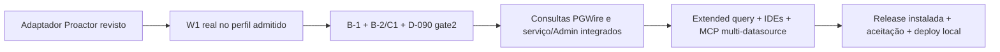

# Entrega em produção: mapa de requisitos e lacunas

Revisão estática de 2026-11-12, sobre o código publicado em `229d82e`.
Não é um aceite de produção nem uma nova execução de testes. Consultar o
Git real antes de retomar; este hash identifica a revisão, não uma guarda
permanente. O objetivo continua sendo IDE → Gateway → PostgreSQL, múltiplos
datasources administráveis e MCP compatível, com masking/read-only intactos.

**O produto ainda não satisfaz esse objetivo.** Há infraestrutura validada,
mas o ingresso PGWire atual recusa consultas, o MCP continua com contrato
de datasource único e a ativação conjunta PGWire/Admin não está entregue.

## Autoridade e método

A delegação para seguir até produção, sem novo aval por lote, está em
`PRODUCTION-EXECUTION.md` §1. Ela substitui restrições históricas de aprovação
por etapa, sem remover os gates ou a limitação atual a trabalho sem efeitos
nativos. Nenhuma permissão nova é inferida para banco existente, segredo,
exposição externa ou alterações do host. O programador continua sendo o
Claude2; root revisa e mede. O fallback autorizado não permite contornar quota.

Foram lidos os requisitos de `PHASE-9-SPEC.md` §14–16, a sequência de entrega,
o plano do destino, a decisão D-119 e os trechos de código citados abaixo.
Medições antigas são identificadas como históricas. Busca ou teste de um
componente não foram usados para provar funcionamento do produto completo.

## Requisitos confrontados com o estado atual

| ID | Requisito de entrega | Evidência inspecionada e conclusão | Prova ainda necessária |
|---|---|---|---|
| R01 | Destino local Oracle Linux9.8 em Docker, configurável e disponível | Destino aceito em `PHASE-9-CONTAINER-TARGET-PLAN.md`; o perfil é userland Oracle sobre o backend Linux do Docker Desktop. Imagem base ou artefato cacheado não são uma instância disponível. **Incompleto.** | Instância da release no destino, identidade/runtime/limites reais, readiness e acesso de teste. Não certificar kernel RHEL/Oracle ou9.9 por esse container. |
| R02 | Vários datasources e políticas pela Admin UX | Etapas1–6 têm implementação e evidência próprias. Porém `bootstrap/main.py` `_build_pgwire_application` recusa Admin/UI junto com PGWire; `_compose` mantém o outro caminho legado. **Ativação integrada incompleta.** | Operador inicia o serviço configurado, administra datasources sem segredo de volta e consulta os aliases pelo PGWire, preservando revisões, concorrência e confirmação de escrita. |
| R03 | Login PGWire, TLS e identidades separadas | Existem listener, composição, TLS e SCRAM em `src/maskgw/pgwire/`; o bootstrap lê a flag externa e prepara o catálogo existente. **Código presente; certificação final no destino não comprovada.** | Login certo/errado sem enumeração, TLS externo sem downgrade, limites de sessão/idle, parada e pacotes instalados nos perfis reivindicados. |
| R04 | SELECT simples com masking pela IDE | `pgwire/driver.py` `_after_ready`, linhas263–272, aceita apenas Terminate (`X`). Outro tipo resulta FEATURE_NOT_SUPPORTED sem ler o corpo. **Consultas não entregues.** | Caminho Q até worker/conexão da sessão, resposta mascarada, proveniência, exceções autoritativas, limites e falha fechada. |
| R05 | Ponte W1 e posse real das portas | Owner puro, host e ponte foram revisados com fakes. Owner `a5d233ae`,194 próprios/1604 relacionados e4 sondagens são evidência do modelo. `oracle9_w1_proactor_pump.py` e seu desenho ainda não existem. **Binding nativo incompleto.** | Desenho/revisão, oráculos/RED, implementação do adaptador e prova nativa de ordem, posse, prazo e recolhimento. Não substituir por mais fakes como entrega final. |
| R06 | B-1: equivalência do pipeline no worker da sessão | `PHASE-9-STAGE-8-DESIGN.md` §5 e evidências B-1 distinguem recompilação/snapshot da integração. **Fim a fim não comprovado.** | Worker instalado com o mesmo engine, policy/HMAC/snapshot e conexão da sessão; comparar resultados/tipos/proveniência e provar reload/lease/isolamento entre datasources. |
| R07 | D-090 gate2: prazo efetivo sem abandonar recurso | O verificador de candidatos e os modelos posteriores não provam contenção de toda validação/masking/consulta. A própria recusa SQL permanece no ingresso. **Gate2 aberto.** | Prazo real imposto pelo dono, falhas/CPU/leitura presa, EOF, término e recolhimento medidos no caminho completo. Retenção incerta não pode ser rotulada cleanup. |
| R08 | B-2/C1 no perfil Docker aprovado | `PHASE-9-CONTAINER-MEMORY-DECISION.md` aprova prospectivamente a opção A, não seu resultado. `DOMAIN-VALIDATION` é reconciliação pura; guard pré-segredo tem prova nativa limitada, não agregado completo. **Gate aberto.** | Critérios6–7 da D-119: pressão/controles negativos, contabilização do agregado, memória/swap/pids/fds, saída em voo, sigilo e comportamento fechado sob OOM. Não transformar AS em RAM nem o perfil em STRICT_PROVEN. |
| R09 | Serviço foreground sem manter stdin artificialmente aberto | `bootstrap/application.py` `Application.run`, linhas276–302, executa MCP stdio e fecha ao terminar. O Containerfile usa esse entrypoint. **Modo de serviço necessário ainda não entregue.** | Serviço PGWire/Admin com lifecycle próprio, configuração externa e shutdown ordenado; preservar o EOF/shutdown do MCP legado. |
| R10 | Extended query, parâmetros e cancelamento | O ingresso pós-auth recusa mensagens que não são Terminate; `pgwire/framing.py` também recusa CancelRequest no startup. **Etapa funcional incompleta.** | Prepared statements/JDBC, estados Parse/Bind/Execute/Sync e cancelamento isolado, com cache/recursos limitados e o mesmo enforcement de read-only/masking. |
| R11 | Navegação nas quatro IDEs certificadas | `PHASE-9-SPEC.md` §14 exige psql, DBeaver, DataGrip e pgAdmin com versões/perfis fixados. O ingresso sem consultas não satisfaz árvore de schemas/tabelas. **Não certificado.** | Navegação e consultas reais em cada perfil, introspecção segura, metadados corretos e documentação do subconjunto PostgreSQL suportado. |
| R12 | MCP multi-datasource com compatibilidade legada | `mcp/server.py`, linhas67–77, continua `query_database(sql: str)` chamando um Gateway. **Seleção de alias/default novo não entregue.** | Alias opcional, default explícito no catálogo, clientes antigos sem parâmetro, rollback legado e MCP exclusivamente stdio, sem SQL/resultados na Admin UI. |
| R13 | Pacote/imagem de release reproduzíveis e atuais | Há wheel próprio e candidata instalada offline medidos em26/10. Isso não certifica release final, retenção atual da imagem ou correspondência com o produto integrado futuro. O Containerfile é uma receita inicial. **Fundação medida; release pendente.** | Wheel/sdist/fechamento Linux e imagem identificados por conteúdo da release; instalação fora do checkout, sem Node no runtime, contexto por allowlist e política de patches das libs empacotadas. |
| R14 | Aceitação e operação segura no destino | `PHASE-9-SPEC.md` §14.2 e `PRODUCTION-EXECUTION.md` exigem PostgreSQL real, clientes, falhas e rollback. Não foram executados nesta revisão. **Entrega não comprovada.** | Matriz integral da release com PG16 descartável, nenhum skip por DSN, testes adversariais/concorrência/UI quando afetada, TLS/segredos externos, backup/rotação/rollback e endpoint de teste realmente disponível. |

“Qualquer IDE” conserva o significado aprovado: PostgreSQL3.0 dentro do
subconjunto implementado e da matriz certificada; não é proxy transparente
ou suporte irrestrito a comandos arbitrários. Não ampliar o projeto para
DLP/governança/RBAC ou remover bloqueios para parecer pronto.

## O que as medições anteriores realmente provam

- Em25/10, a rodada10 de `PHASE-9-ORACLE9-PYTHON-VALIDATION.md` mediu
  Oracle9.8/Python3.11.13 numa imagem intermediária; não um Gateway ativo.
- Em26/10, `APP-WHEEL-VALIDATION` produziu dois wheels iguais naquele
  ambiente/processo. `OFFLINE-INSTALL-VALIDATION` mediu39 distribuições e
  imports na candidata87871290. Ambos excluem listener, consultas e release.
  A retenção atual desses artefatos não foi consultada nesta revisão.
- `PROCESS-GUARD-VALIDATION` mediu controles pré-segredo em container
  isolado. Não prova todos os processos/custos da aplicação integrada.
- Em12/11, owner/ponte/host passaram a matriz pura e quatro sondagens de
  prazo. São provas relevantes do controle, sem syscall/loop/subprocesso
  nativo do produto neste lote. Não fecham R05–R08 ou R14.

Revisão dirigida de R13: `ORACLE9-RELEASE-DEPENDENCY-REVIEW-2026-11-12.md`
confronta as três cópias SSL registradas com avisos oficiais e distingue
versão upstream, backport e alcance. Não é exploração reproduzida ou troca
de pins, não invalida automaticamente o uso secretless W1 e não certifica
as dependências de release por um simples update do RPM do sistema.

## Sequência que aproxima o resultado solicitado

Cada seta depende de evidência própria; não é um prazo ou declaração de
gate fechado. O próximo lote do programador permanece somente o desenho
Proactor. A revisão prévia está em `PHASE-9-W1-ORACLE-PROACTOR-REVIEW.md`.
Depois vêm testes revistos/RED, fonte e as provas nativas autorizadas no
procedimento próprio. Não adicionar outra camada genérica de simulação.

## Retomada, autoridade e dados externos

Em12/11, a tarefa existente foi consultada/atualizada/relida e está Pronta
para20h05SP, mesma conversa, IgnoreNew e `--resume`. Isso prova configuração
do agendamento; não prova entrega futura nem liberação de quota. Claude2
permanece na mesma sessão/modelo/medium após o horário informado; não há
programador ativo ou permissão para contornar limites por outra conta/modelo.

DNS/certificados/portas finais e origem de segredos serão configurados
externamente no procedimento de implantação. O destino local/loopback já
foi identificado; esses dados não impedem desenho/revisão independentes.
Não usar o banco/credenciais antigos de aceitação ou presumir exposição
externa. Não executar Docker, PostgreSQL, SQL ou operações nativas neste lote.

Os riscos aceitos já documentados não foram convertidos em novos bloqueios
nem em findings corrigidos. Masking, read-only, proveniência, confirmação,
isolamento, sigilo e ausência de abandono de recursos continuam requisitos.

Este mapa cobre lacunas concretas até o resultado final; não redefine sucesso
como “testes puros verdes”. O objetivo permanece ativo e não concluído.
